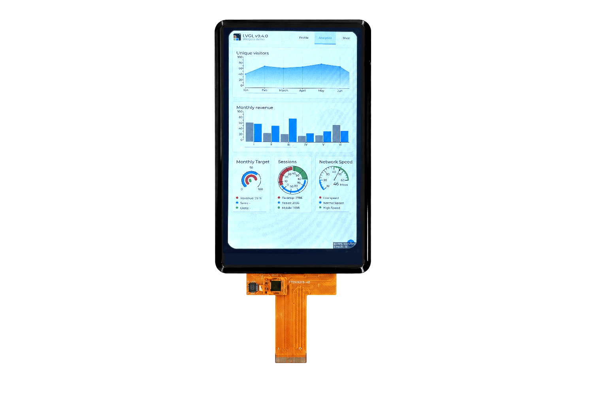

<p align="left"></p>

<h1 align="center">OSPTEK 5″ TFT Display 720×1280 (YDP500BT004-V1)</h1>

<p align="center"><b>TFT module · MIPI · JD9365</b></p>

<p align="center"><a href="./README.md">简体中文</a> | English · <a href="../../README_EN.md">Family index</a></p>

<p align="center">
  
  
</p>

<p align="center"></p>

## Contents

- [Specifications](#specifications)
- [Resources](#resources)
- [Repository layout](#repository-layout)
- [Buy](#buy)
- [Support](#support)

---

## Specifications

| Item | Spec |
| ---- | ---- |
| Size | 5 inch |
| Type | TFT |
| Resolution | 720×1280 |
| Outline | 66.4 x 120.05 mm |
| Active area | 61.78 x 109.85 mm |
| Interface | MIPI |
| Driver IC | JD9365 |
| Touch IC | — |

> Full outline, FPC definition, power, and timing follow the product datasheet / driver IC datasheet.

## Resources

| Category | File |
| ---- | ---- |
| Datasheet | [`JD9365DA-H3_User_Guide_Preliminary_V0.02_20230816.pdf`](./datasheets/JD9365DA-H3_User_Guide_Preliminary_V0.02_20230816.pdf) |
| Datasheet | [`JD9365D_DS_Preliminary_V0.01_20170427(1)(2).pdf`](./datasheets/JD9365D_DS_Preliminary_V0.01_20170427%281%29%282%29.pdf) |
| Datasheet | [`YDP500B004-V1.pdf`](./datasheets/YDP500B004-V1.pdf) |
| Datasheet | [`YDP500BT004-V1.pdf`](./datasheets/YDP500BT004-V1.pdf) |
| CAD file | [`YDP500BT004-V1.dwg`](./cad/YDP500BT004-V1.dwg) |
| Adapter materials | [`adapter-pinout-compare.png`](./adapter/adapter-pinout-compare.png) |
| Adapter materials | [`SCH_TFT050BT231转接板V1.0_2026-08-03.pdf`](./adapter/SCH_TFT050BT231%E8%BD%AC%E6%8E%A5%E6%9D%BFV1.0_2026-08-03.pdf) |

## Repository layout

```text
display-tft-5inch-720x1280/ # repo root (nav: ../../README_EN.md; sample projects under root examples/)
└── versions/
    └── YDP500BT004-V1/        # full materials for this part number
        ├── README.md
        ├── README_EN.md
        ├── osptek.yml
        ├── images/
        ├── datasheets/       # product datasheet + driver/touch IC datasheets
        ├── cad/              # outline/cover CAD
        └── adapter/          # adapter board materials + photos
```

## Buy

See the [repo home page](../../README_EN.md#where-to-buy).

## Support

See the [repo home page](../../README_EN.md#support).

---

<p align="center"><sub>© 2026 OSPTEK · Materials in this repository are licensed under CC BY 4.0</sub></p>
